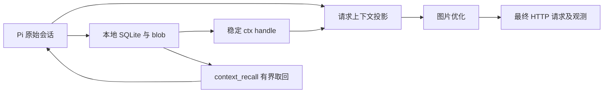

# 流量优化与上下文归档：技术参考（开发维护环境）

本文件是实现、配置与故障恢复的技术参考，面向开发维护环境；开发与发布流程见仓库根目录的 `AGENTS.md`，公开用法见 `README.md`。多协议接入曾在 Ubuntu、Node 24.22.1、Pi 1.5.0 上现场验证；原实现曾在 Windows、Node 24.18.0、Pi 1.0.1 上验证，新增协议尚未在 Windows 现场复测。SDK 测试优先使用 `npm ci` 安装的 devDependencies 中的 Pi，其次查找 Windows npm 全局目录或 Linux 当前 Node 安装前缀，可用 `PI_TRAFFIC_OPT_PI_ROOT` 指定安装目录。

修改扩展或配置后，在 Pi 运行 `/reload` 或重启。入口在每次加载时计算 `src/` 内实现文件的源码 hash，用同一版本的原生 ESM URL 加载整个依赖图，避免 reload 复用旧 MJS 实现；源码未变时保持模块版本稳定。升级归档实现前应退出使用同一归档目录的所有 Pi 进程并备份目录。

## 数据流和边界

Pi 的 canonical session 保存原始消息、工具调用和工具结果。`tool_call`、`tool_result` 和 `message_end` 只观察并归档；`context_with_system` 返回本次 provider 请求的副本。原消息的顺序、角色和 `toolCallId` 保持不变。



工具正文、文件 snapshot 和图片可靠落盘后才能用 placeholder 替换历史内容。placeholder 按 session/source 保存，后续请求复用。已投影的历史 prefix 在再次 recall 时保持稳定，取回的数据出现在新的工具返回页中。到期的 recall 页独立归档，因此可以精确取回当时返回的页。

工具正文保护最近的 turn 和 token 工作集。图片按 turn 和 HOT lease 保护，避免少量文本使旧图片长期保留 Base64。图片可以单独替换为 handle，同时保留工具结果的正文。投影采用**缓存感知批量滞回 GC**：压力按应用已有投影后的当前激活上下文（UTF-8 估算并结合实测 API usage 动态校准）计算，不计入早已归档的原文长度；非 GC 轮次保持前缀只追加不修改以保护 Prompt Cache（如 Gemini Implicit Caching），仅当可回收批量达到当前压力分档门槛并满足冷却间隔或达到紧急水位时，一次性批量清理全部已冷却的非保护候选（含到期 recall 页）。

`WARM` 表示通常工作集，`HOT` 表示 recall 后的保护期，`COLD` 表示到期后可驱逐，`ARCHIVED` 表示历史内容已有投影。保护期需要同时经过 turn 和时间条件；重复取回会增加 turn 保护。对象可能对应多个历史位置，usage 是对象级辅助状态。

原 user 文本和 assistant 文本、工具调用参数保留在 provider 上下文中。正常投影和 recall 不调用额外 LLM，不引入 embedding 或外部数据库。Pi 原生 compact 保留：扩展仅在投影后的估算压力及 Pi 的 context usage 都达到 emergency、Agent 空闲且冷却期结束时请求补充 compact。原生 compact 可以独立触发，原会话记录仍由 Pi 管理。

## 模块和目录

| 文件或目录 | 用途 |
|---|---|
| `src/index.ts` | Pi 1.x 事件、工具、命令、开关与请求观测接入 |
| `src/module-loader.mjs` | 原生 ESM 加载桥，保留 URL 的源码版本参数 |
| `src/optimizer.mjs` | 原图片处理、内存/磁盘缓存和失败回退 |
| `src/context-memory.mjs` | provenance、snapshot、投影、lease、working state、recall |
| `src/archive.mjs` | SQLite WAL、FTS5、内容寻址 blob、事务和 GC |
| `src/configuration.mjs` | 配置默认值及边界校验 |
| `src/profile.mjs` | 协议结构、推理端点匹配、正文分类与图片来源 |
| `src/transport.mjs` | fetch、Node HTTP/1 与 HTTP/2 的最终正文及响应状态观测 |
| `src/reporting.mjs` | 增量事件、CSV 和有界汇总报告 |
| `<数据目录>/archive/index.sqlite` | 对象、blob 引用、关系、usage、projection 和 FTS 索引 |
| `<数据目录>/archive/blobs/<sha256>.blob` | 工具内容、完整可用 stdout、参数、原图和优化图 |
| `<数据目录>/reports/<时间>-<pid>/` | 每个 Pi 进程的流量记录 |
| `reports/benchmarks/`（仓库内，已忽略） | 本地 HTTP/SSE 对照、canonical session 和报告 |

`<数据目录>` 默认为 Pi 配置目录下的 `traffic-optimization/`（`~/.pi/agent/traffic-optimization/`，`PI_CODING_AGENT_DIR` 可改变 Pi 配置目录）。数据不放在扩展包目录，npm 包更新不会覆盖配置、归档和报告。

| 环境变量 | 默认位置或用途 |
|---|---|
| `PI_TRAFFIC_OPT_CONFIG_PATH` | `<数据目录>/config.json` |
| `PI_TRAFFIC_OPT_ARCHIVE_DIR` | `<数据目录>/archive/` |
| `PI_TRAFFIC_OPT_CACHE_DIR` | 系统临时目录下的 `pi-image-optimizer` |
| `PI_TRAFFIC_OPT_REPORT_DIR` | 本次运行的报告目录，默认 `<数据目录>/reports/<时间>-<pid>/` |
| `PI_TRAFFIC_OPT_PI_ROOT` | 维护 SDK 测试使用的 Pi 安装目录 |

维护环境建议设置绝对路径。归档含原始代码、日志、参数和图片；报告也可能包含路径、命令及模型端点，分享时需要检查内容。

## 协议与传输

图片压缩和历史投影在 provider 转换之前执行。流量观测按当前模型的 API、端点和实际正文结构匹配，支持以下 Pi 内置协议：

| API | 请求入口 | 传输 |
|---|---|---|
| `openai-responses` / `azure-openai-responses` | `/responses`，包含 Azure 路径规范化 | fetch |
| `openai-codex-responses` | `/codex/responses`，支持已含入口的 baseUrl | fetch |
| `openai-completions` | `/chat/completions` | fetch |
| `mistral-conversations` | `/v1/chat/completions`，使用最终 snake_case 正文 | fetch |
| `anthropic-messages` | `/v1/messages` | fetch |
| `google-generative-ai` / `google-vertex` | `models/<模型>:streamGenerateContent` | fetch |
| `bedrock-converse-stream` | `/model/<模型>/converse-stream` | Node HTTP/2、代理或强制 HTTP/1 |
| `pi-messages` | `/messages` | fetch |
| `antigravity-acp` | `acp://antigravity-cli` 与 `/mcp-result` | `before_provider_request` 直接载荷观测（`acp-stdio`）与活跃轮次宿主 MCP 工具结果回传（`acp-mcp-result`） |

分类覆盖系统提示、用户及 assistant 文本、工具参数、工具结果、工具 schema 和图片。图片支持 data URL、Anthropic Base64 source、Google inlineData、Bedrock image bytes、Pi image block 和 ACP prompt/resource 图片块；远程图片 URL 不计为本次上传的 Base64。HTTP 端点不保存查询参数或 URL 凭据。

图片压缩率按本次实际出站载荷中的图片 SHA-256 精确匹配累加，适应有状态增量传输协议；归档复用的已优化图片不覆盖原图压缩记录，也不借用历史原图大小虚增压缩率。在 `pi-antigravity-bridge` 的 `hybrid` / `agy-tools` 模式下，`agy_read`、`agy_edit`、`agy_write`、`agy_bash` 及带 `details.diffs` 的镜像工具纳入归档与工作状态追踪，`agy_edit`/`agy_write` 变更会自动失效对应本地文件版本缓存，并将既有 `read` 与 `agy_read` 快照标为过期；`agy-tools` 模式停用 `context_recall` 时自动跳过上下文投影并清理旧投影压力估算，图片压缩与 `acp-stdio` 流量观测继续工作。`acp-stdio` 仅计量实际经 `session/prompt` 发送的载荷（桥接层经本地 SQLite 恢复或预注入的历史步不计入本次载荷）；历史重放中 `<assistant>` 内嵌的 `<tool_call>` 计入 `tool_call_bytes`。多工具并发分摊产生的极小输入 token 切片，以及有状态 ACP 活跃轮次中途触发 GC 后、下一次 `acp-stdio` 同步重建前的脱节样本，均会被上下文校准器忽略。会话、分支或模型切换时自动清理瞬态请求状态。

fetch 支持字符串、URL、Request，以及字符串、二进制或 Blob 正文。`gzip`、`deflate`、`br` 和 `zstd` 正文按实际压缩字节计入累计上传，分类使用解压后的 JSON。单次解压上限为 256 MiB；无法解码的正文跳过观测，原请求继续发送。每次重试分别记录实际请求与响应状态；assistant 完成后清除本次候选请求。

HTTP/2 观测依赖 Node 的 `http2.client.stream` diagnostics channels；缺少相应频道的运行时无法采集该路径。WebSocket 暂无上传计量，转换前的图片压缩与投影继续工作。未知 API 不推断流量分类。

## 配置

配置文件不存在或字段缺失时使用 `src/configuration.mjs` 与 `src/optimizer.mjs` 中的默认值；`config.example.json` 列出全部字段，其中 `logging` 为 `off`，代码默认值为 `summary`。修改默认值时同步更新两处和本节表格。以下 KB/MB 容量按 1024 进制计算。

图片参数保持原行为：低于 300 KiB 默认跳过，目标 375 KiB，最长边 1920，默认 quality 82、最低 60、最高 88，保留透明通道；收益不足 5% 使用原图。缓存默认 1024 MiB / 7 天，内存图片缓存为 64 MiB。图片处理或缓存失败时保留原图。原图指扩展收到的 image block，Pi 自身的图片预处理可能已经发生。归档保存原图和选定的优化版本，recall 优先复用已保存版本。

`contextOptimization` 的配置：

| 字段 | 默认值 | 作用 |
|---|---:|---|
| `enabled` | true | 上下文归档系统开关 |
| `archiveToolResults` | true | 自动归档工具结果及其中的图片 |
| `projection` | true | 请求时生成历史投影 |
| `recall` | true | 暴露取回工具；关闭时停止投影 |
| `historySearch` | true | 启用 FTS5/BM25 历史检索 |
| `llmCompactFallback` | true | 允许扩展在 emergency 请求原生 compact |
| `minimumToolResultBytes` | 4096 | 可投影工具正文的最小大小 |
| `oversizedToolResultBytes` | 32768 | 低压力时超大对象阈值，覆盖约 50 KiB 的实际工具输出 |
| `keepRecentTurns` / `keepRecentTokens` | 4 / 12000 | 正文工作集保护；图片采用 turn 保护 |
| `hotLeaseTurns` / `hotLeaseSeconds` | 4 / 120 | recall 后的最小保护 |
| `reuseLeaseBonusTurns` / `maxLeaseTurns` | 2 / 20 | 重复取回的保护增量和上限 |
| `fallbackCooldownSeconds` | 300 | 扩展请求 compact 的冷却期 |
| `stateLimit` | 12 | 每类 working state 的记录上限 |
| `thresholds.low / medium / high / emergency` | .60 / .75 / .90 / .95 | 有效上下文估算压力分级 |
| `thresholds.target / aggressiveTarget` | .60 / .40 | 历史兼容目标阈值 |

`contextOptimization.gc` 的缓存感知批量回收配置：

| 字段 | 默认值 | 作用 |
|---|---:|---|
| `lowPressureMinReclaimTokens` / `lowPressureMinReclaimShare` | 65536 / 0.45 | 低压力（`< low`）触发批量清扫的最小可回收 token 与占比 |
| `lowMediumMinBatchTokens` / `lowMediumMinBatchShare` | 49152 / 0.25 | 中低缓冲区（`low ~ medium`）批量清扫门槛 |
| `minBatchTokens` / `minBatchShare` | 32768 / 0.12 | 常规压力（`>= medium`）批量清扫门槛 |
| `highPressureMinBatchTokens` / `highPressureMinBatchShare` | 16384 / 0.04 | 高压力（`>= high`）批量清扫门槛 |
| `emergencyMinBatchTokens` | 4096 | 紧急水位（`>= emergency`）最小有效回收下限 |
| `cooldownTurns` | 8 | 两次非 high/emergency 批量清扫间的最小冷却 turn 数 |
| `minCacheableTokens` | 8192 | 低于此剩余前缀规模的小型上下文不按大型缓存拦截 |

`contextOptimization.archive` 的配置：

| 字段 | 默认值 | 作用 |
|---|---:|---|
| `maxSizeMB` / `retentionDays` | 2048 / 30 | 索引与已索引 blob 的容量预算、非活跃对象保留期 |
| `maxObjectMB` | 32 | 单个 blob 上限 |
| `maxFileHashMB` | 64 | 文件 hash / live 读取的安全上限 |
| `maxMetadataArgumentBytes` | 8192 | 超出后参数存独立 blob |
| `maxSnapshotProofBytes / maxSnapshotProofLines` | 1048576 / 10000 | read 前后 snapshot 核对的范围上限 |
| `maxIndexChars` | 262144 | 单对象可检索文本字符上限 |
| `maintenanceSeconds` | 300 | 空闲维护间隔 |

`contextOptimization.recallOptions` 的配置：

| 字段 | 默认值 |
|---|---:|
| `pageLines / maxPageLines` | 80 / 400 |
| `maxBytes / maxFullBytes` | 16384 / 65536 |
| `maxMatches / maxAround` | 20 / 60 |
| `maxImages / maxImageMB` | 4 / 16 |
| `searchLimit / maxSearchLimit` | 10 / 30 |

`reporting` 默认每 30 秒写摘要，保留 14 天；跨运行预算 256 MiB、单次增量事件预算 32 MiB、内存明细保留 200 条。报告达到事件预算后计入 `dropped_events`，累计请求聚合继续保留。WAL、SHM 和未确认的孤立文件可能使实际磁盘占用高于归档的已索引预算，benchmark 同时记录实际目录大小。

## 命令和开关

- `/traffic-opt`、`开`、`关`：总开关，写回配置，重启后保持。
- `/traffic-opt 状态`、`统计`：状态及累计指标；统计会刷新报告。
- `/traffic-opt 上下文`：working state、归档、投影和 recall 指标。
- `/traffic-opt archive`：归档目录与使用情况。
- `/traffic-opt recall <实际 ctx handle>`：查看对象 metadata。
- `/traffic-opt gc`：执行一次维护；活跃 session 引用及 lease 受保护。
- `/traffic-opt 清理缓存`：清理图片优化缓存，归档仍保留已保存的图片版本。

关闭后暂停压缩、投影、自动归档及新增请求观测，并隐藏 recall；请求恢复 Pi 提供的完整上下文。页脚保留本进程之前的计数。重新开启后从原会话恢复归档与稳定投影。关闭不能恢复已由 Pi 原生 compact 改变的当前窗口，完整历史仍保留在 Pi session 文件中。

左下状态行保留累计上传、最近请求大小和图片压缩率三个指标。非交互模式继续执行处理和记录。

## context_recall

有 handle 时优先精确取回。没有 handle 时使用 provenance/关系，再使用 FTS。工具参数中的 `id` 需要填写响应里真实的 `ctx://tool/<sha256>` 或 `ctx://image/<sha256>`。

| 参数 | 行为 |
|---|---|
| `id` | 精确取回本地对象 |
| `query` | 与 id 合用时过滤内容；单独使用时 FTS 搜索 |
| `toolName / path / allSessions` | 搜索过滤；默认只检索当前 session 引用的对象 |
| `offset / limit` | 归档内容的 1-based 行分页；搜索时为结果分页 |
| `lineStart / lineEnd / head / tail / around` | 局部证据窗口 |
| `byteOffset` | 超长单行的 UTF-8 字节续页；使用返回的 `nextByteOffset` |
| `full` | 提高单次字节额度，仍受行数与字节上限限制 |
| `metadataOnly / related` | 返回 metadata 或关系；较大 metadata 有分页回退 |
| `part=content/arguments/structured` | 取回正文、原参数或可用结构化返回；参数与结构化视图不附带图片 |
| `view=snapshot/current/diff` | 默认历史 snapshot；current/diff 适用于本地文本 read |
| `imageVersion=optimized/original` | 图片对象采用保存的优化图或原图 |
| `imageOffset` | 工具结果内的图片分页，返回 `nextImageOffset` |
| `workingState` | 返回机器可读工作状态 |

`range` 保存原 read 的请求范围；分页行号相对于归档返回内容。原工具截断提示也属于 snapshot。`createdAt` 表示对象创建时间，`sourceTimestamp` 记录可用的来源时间。文件核对使用 hash 和 read 前后证据，明确返回 `current`、`stale` 或 `unverified`。`edit/write` 使旧 read 记录失效；再次核对旧记录不会把相同路径的新有效记录标成 stale。

`current` 明确读取当前文件，`diff` 返回按行对照。diff 包含原工具显示文本，不能作为可直接应用的统一补丁。图片对象以及含图片的 read 不支持 current/diff；需要当前图片时调用当前文件读取。图片 recall 返回真实 image block，并避免再次 Sharp 编码。

大输出有界返回 `nextOffset`、`nextByteOffset` 或 `nextImageOffset`。FTS 只覆盖配置允许的索引前缀；已知 handle 的局部过滤可以检查完整已保存内容。扩展提供优先 recall 的工具说明，未自动拦截模型自行重复执行工具。

## 维护、故障和恢复

SQLite 使用 WAL 和 FTS5，schema 当前为 1。原型数据库的 owner 表会补充 `pid`；无法确认 PID 的旧 owner 引用保留。较新 schema 会停止归档写入并回退到原上下文。

blob 经 SHA-256 校验、fsync 和原子 rename 后提交 metadata。写入和 GC 共享写队列及 SQLite 写锁；部分写入或容量不足会回滚。GC 先提交过期 metadata 删除，再清理无引用文件；无法确认 metadata 引用时保留文件。活跃 session、跨 session 引用及 lease 保护对象。未提交的孤立 blob 和临时文件在一天后由维护清理。

目录不可写、SQLite/FTS 不可用、metadata 或 blob 损坏、容量不足时，相关消息保留原内容；图片与报告故障分别回退。recall 无法取回时返回工具错误，模型仍可依赖完整 canonical 历史。稳定 placeholder 需要本地归档存在；迁移 session 时应一并保存归档目录。

恢复步骤：退出使用该目录的全部 Pi 进程，备份完整归档目录和对应 Pi session 文件，再修复目录权限或从完整备份还原 `index.sqlite` 与 `blobs/`。进程仍运行时，备份必须包含 SQLite 的 WAL 状态；正常关闭后 WAL/SHM 已释放。需要重建时可以把故障目录改名保留，创建新归档并重新加载原 session；历史 read 缺少现场核对证据时标为 unverified。归档中额外保存的完整 stdout 和独立参数也应随备份保留。

图片缓存可以独立清理。恢复操作应保留原会话和旧归档副本。

## 验证和报告

在仓库根目录执行：

```bash
npm ci
npm run check
npm test
npm run test:sdk
npm run benchmark
```

`npm test` 已包含 SDK 测试。`test:sdk` 独立运行长会话和多协议集成测试，使用本机 Pi 的真实 serializer、本地 HTTP/SSE 及 Bedrock HTTP/2 event stream，核对归档投影、用户及工具图片、canonical 历史、响应解析与最终请求字节。benchmark 使用真实 Pi SDK、内置工具、provider serializer 和本地 HTTP/SSE 服务，生成单独时间目录；指定目录时使用全新目录以隔离数据库与旧报告。

主 HTTP 对照使用默认 4 turns / 12000 tokens / 32768 bytes。native compact 和 recall 对照使用较小工作集覆盖边界。请求 body 在最终传输入口及本地服务器两侧核对；provider usage 是本地测试数据，未调用远程 LLM。报告包含运行代码 SHA-256、CPU、耗时分位、归档目录大小、recall 页和原工具执行次数。

每个流量运行目录包含 `events.jsonl`、`requests.csv`、`images.csv`、`summary.json`、`report.md`。CSV 的 request/update 行按 request_id 合并；update 不计为新请求。明细有内存与磁盘预算，汇总不依赖无限保存明细。

- `total_upload_bytes` / 请求行的 `total_payload_bytes`：最终匹配的 HTTP 请求体字节，包含重试；压缩请求使用压缩后的大小。
- `json_payload_bytes`：实际请求体解压后的 JSON UTF-8 字节；正文分类之和等于该字段，图片占比也以此为分母。未压缩请求与 `total_payload_bytes` 相同。
- `candidate_payload_bytes`：`before_provider_request` 阶段的序列化大小，单独记录 Google、Mistral、Bedrock 等协议后续转换前的候选数据。
- `tool_bytes_projected`：context 正文 UTF-8 差，不能直接当 HTTP 节省。
- `image_bytes_avoided`：优化图片二进制的 counterfactual 避免量。
- token 压力及 compact 压力缓解：estimated；缺少未投影的真实 HTTP 对照时，HTTP 节省为 null。
- p50/p95 请求大小：对数直方图估算；benchmark 的耗时分位来自实际样本。
- HTTP profiler 覆盖上表中的实际请求路径；WebSocket、响应正文、TCP/TLS 字节未计量。

现场维护验证的结果只证明相应环境和工作负载。默认对照可验证上传量变化；本地 synthetic usage 的 compact 次数不能推广为真实远程模型的保证。

回归测试包含全部 10 种内置协议的真实 SDK 序列化及本地传输验证。reload 回归在隔离副本中修改真实 ContextMemory 及它依赖的 ContextArchive，确认再次加载取得两层新实现。测试数量与平台结果以 CI 记录为准。

早期单协议对照保存在维护者本机报告目录的 `reports/benchmarks/context-v1-reload/`（`report.md` 与 `benchmark.json`，未纳入仓库）。该历史对照包含 22 次本地 HTTP 请求，最终 body 从 1,560,343 bytes 降至 230,999 bytes；数值仅对应当时的实现与工作负载。
